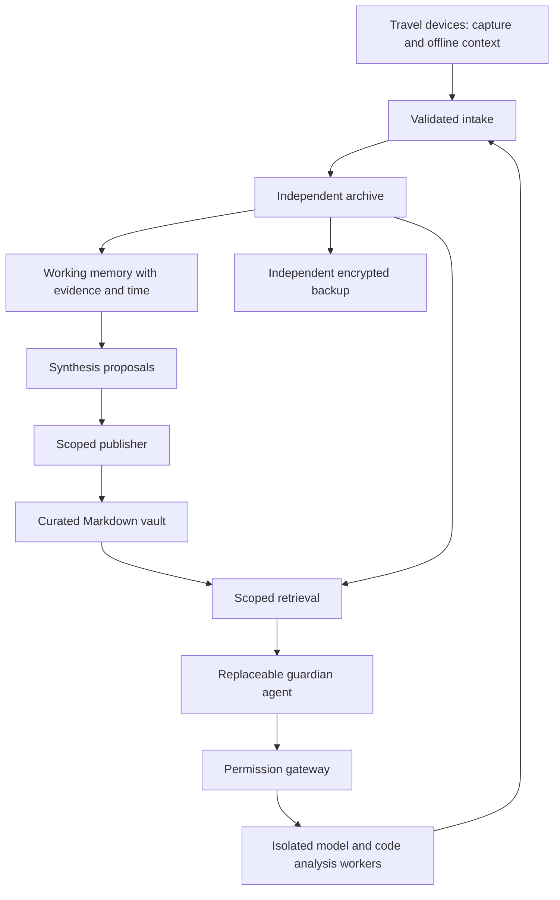

# Lamassu

### A personal guardian with a long memory and bounded authority.

**An open-source research project by [UpBeam Research](https://research.upbeam.net), a subdivision of UpBeam OY.**

[Research direction](docs/VISION.md) · [Architecture](docs/ARCHITECTURE.md) · [Roadmap](docs/ROADMAP.md) · [Contribute](CONTRIBUTING.md)

---

Your knowledge should remain yours as devices change, projects evolve, and new AI models arrive.

Lamassu explores a personal AI system that can accompany you across those changes. It preserves original conversations in an independent archive, builds working memory with traceable evidence, and brings the understanding worth keeping into a human-owned Markdown vault. A replaceable agent uses that knowledge within explicit permissions.

The name evokes a guardian at the gate. Our research asks what it would take for a personal agent to earn that role: accurate recall, useful initiative, understandable decisions, and limits that hold.

## The research

We are developing Lamassu around three questions:

- **Continuity:** Can personal knowledge survive changes in models, software, devices, and connectivity?
- **Understanding:** Can an agent connect conversations, decisions, documents, and code without losing the evidence or confusing inference with fact?
- **Stewardship:** Can it become more useful over time while its authority remains under the owner's control?

The intended experience is practical: capture a thought while travelling, resume a project from a short brief, follow a decision back to its sources, and receive a warning when something meaningful needs attention.

## Three layers of memory

| Layer | Purpose | Durable record |
| --- | --- | --- |
| **Archive** | Preserve what happened | Original conversations, source documents, attachments, and revisions |
| **Working memory** | Connect and interpret | Sourced observations, timelines, relationships, uncertainty, and proposed syntheses |
| **Curated knowledge** | Carry understanding forward | Reviewed notes, decisions, principles, and project maps in Markdown |

Obsidian is one possible home for curated knowledge. The archive and core data model must remain usable independently of any particular client or model provider.

## Development status

**Pre-alpha · Research prototype**

The current implementation is a small local archive core. It can:

- Import explicitly prepared `lamassu.conversation.v1` JSON records into SQLite.
- Preserve exact input bytes and a SHA-256 digest, with idempotent repeat imports.
- Retain changed exports as separate revisions.
- Search message text locally and return source record and message identifiers.
- Reject malformed records before writing them to the archive.

Native provider imports, semantic memory, vault publishing, device synchronization, model integration, and isolated codebase analysis are planned work. The prototype opens no network service and takes no autonomous actions. No provider-export compatibility or production security guarantee is claimed.

## Try the archive prototype

Requires **Python 3.10 or newer**. There are no third-party runtime dependencies. From a checkout of this repository:

```sh
python3 -m lamassu --database /tmp/lamassu-demo.sqlite import examples/conversation.json
python3 -m lamassu --database /tmp/lamassu-demo.sqlite search guardian
python3 -m unittest discover -s tests -v
```

The example is synthetic. The database stores plaintext; encryption, access control, and backups are not implemented. Keep real records on private storage outside the checkout. Search includes all matching revisions and does not determine which statements are currently true. Read the [threat model](docs/THREAT_MODEL.md) before considering personal-data experiments.

## Architecture we are working toward



This diagram describes the proposed system, not a set of deployed services. Execution workers, publishing rights, private memory, and backup administration have separate trust boundaries. Models and indexes are replaceable; original evidence and reviewed knowledge are the durable assets.

## Follow the work

- [Research direction and success criteria](docs/VISION.md)
- [Architecture and data contract](docs/ARCHITECTURE.md)
- [Threat model and current limitations](docs/THREAT_MODEL.md)
- [Delivery roadmap](docs/ROADMAP.md)
- [Existing projects under evaluation](docs/RESEARCH.md)
- [Architecture decisions](docs/decisions/0001-foundation.md)
- [Project stewardship](docs/STEWARDSHIP.md)
- [Open issues](https://github.com/Autio/lamassu/issues)

We evaluate existing tools before committing to custom implementations. Research notes distinguish documented capabilities from behavior we have actually tested.

## Contribute

We welcome focused improvements, reproducible evaluations, and careful criticism. Start with the [contribution guide](CONTRIBUTING.md) and [roadmap](docs/ROADMAP.md). Changes should state what works, how it was verified, and what remains uncertain.

Public examples and tests use synthetic data. Personal deployments, chat exports, company source, credentials, and private findings stay outside this repository. See [security reporting](SECURITY.md) for sensitive reports and [AGENTS.md](AGENTS.md) for contributor-agent instructions.

## License and attribution

Lamassu is developed by **UpBeam Research**, a subdivision of **UpBeam OY**, with project information at [research.upbeam.net](https://research.upbeam.net).

The code is available under the [MIT license](LICENSE). Third-party integrations retain their own licenses. Lamassu is a working project name; package availability and trademark clearance have not been established.
