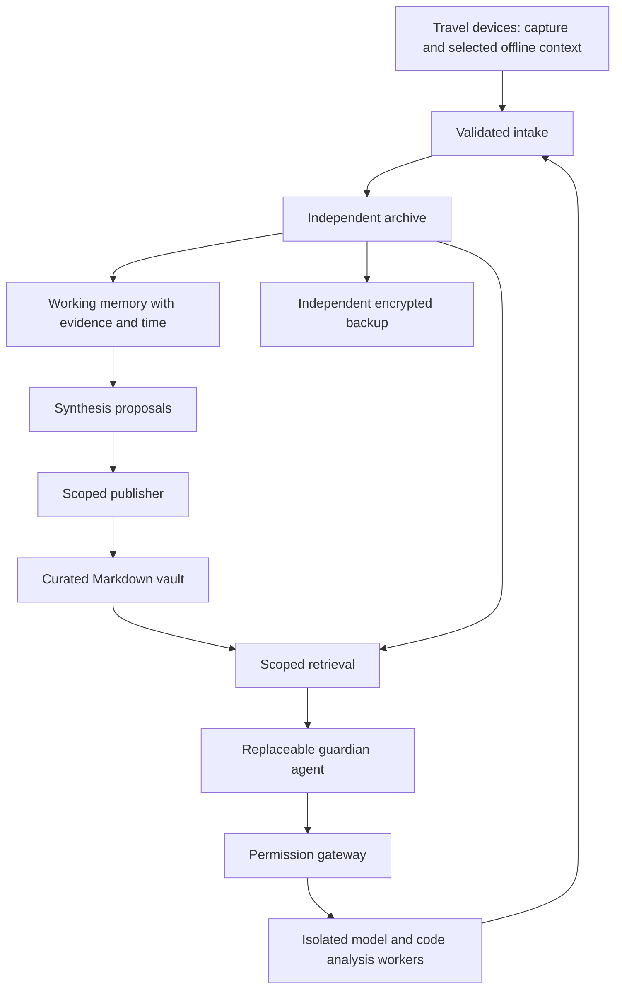

# Lamassu

A personal guardian with a long memory and bounded authority.

Lamassu is an experimental, local-first foundation for a personal AI system that can accompany someone across devices, projects, and years. Preserve original conversations, build traceable working memory, and publish the syntheses worth keeping into a human-owned Markdown vault.

**Status: pre-alpha.** This repository contains a design, a roadmap, and a small runnable archive prototype. It is not a deployed guardian, security product, or replacement for backups. No cloud services, model calls, scheduled jobs, or agent actions are enabled by the prototype.

The working name refers to the protective figure at the gate. The useful ambition is stewardship: remember accurately, explain the evidence, ask at consequential boundaries, and remain replaceable.

## What works today

- Import explicitly prepared `lamassu.conversation.v1` JSON records into a local SQLite archive.
- Preserve exact input bytes and a SHA-256 digest; repeat imports are idempotent.
- Keep changed exports as separate revisions rather than silently replacing history.
- Search message text locally and return message IDs, record IDs, and revisions.
- Reject malformed records before database writes. No provider export compatibility is claimed.

## Try it

Requires Python 3.10 or newer, with no third-party runtime dependencies. From this directory:

```sh
python3 -m lamassu --database /tmp/lamassu-demo.sqlite import examples/conversation.json
python3 -m lamassu --database /tmp/lamassu-demo.sqlite search guardian
python3 -m unittest discover -s tests -v
```

The demo is synthetic. For real use, put the database on private storage outside this repository. It contains plaintext personal data; encryption, access control, and backups are deployment responsibilities and are not implemented here. Search returns all matching revisions, including superseded exports; it does not resolve current truth.

## Intended system



Solid components in this diagram describe the intended architecture, not implemented services. Models, search indexes, and agent runtimes are replaceable. Original evidence and user-reviewed knowledge are the durable assets.

## Start here

- [Product direction](docs/VISION.md)
- [Architecture and data contract](docs/ARCHITECTURE.md)
- [Threat model](docs/THREAT_MODEL.md)
- [Delivery roadmap](docs/ROADMAP.md)
- [Research candidates](docs/RESEARCH.md)
- [Architecture decisions](docs/decisions/0001-foundation.md)
- [Contributing](CONTRIBUTING.md) and [security reporting](SECURITY.md)

## Open development

Use small reviewed changes, synthetic fixtures, explicit acceptance criteria, and tested migrations. Personal deployments, credentials, chat exports, company source, and findings stay outside this public repository. See [AGENTS.md](AGENTS.md) for contributor-agent rules.

MIT licensed. The project includes no third-party agent code. Candidate integrations retain their own licenses. Lamassu is a working name; no package-name or trademark clearance is claimed.
