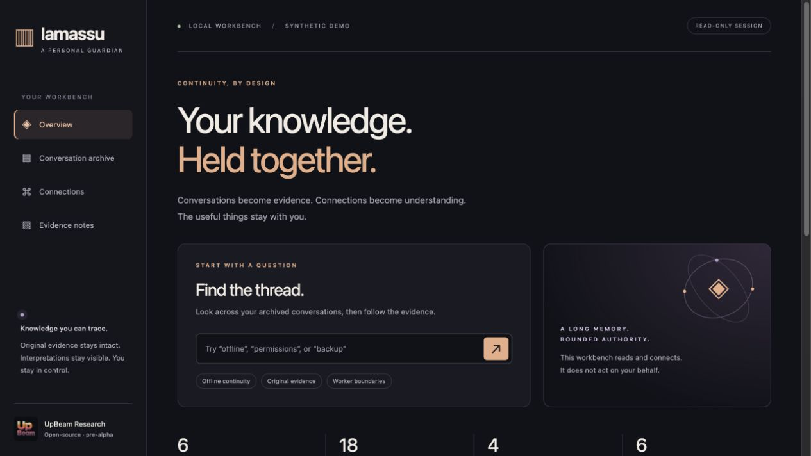
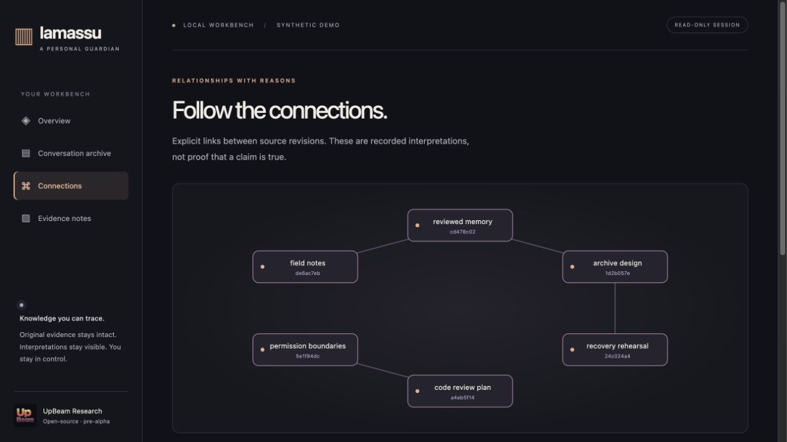
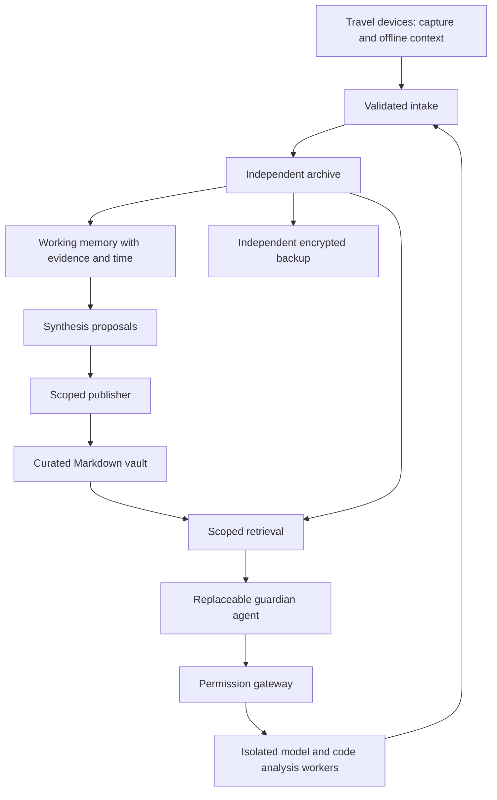

<p align="left"></p>

# Lamassu

### Your knowledge. Held together.

A personal guardian with a long memory and bounded authority. An open-source research project by **[UpBeam Research](https://research.upbeam.net)**, a subdivision of **UpBeam OY**.

[Try the workbench](#try-the-workbench) · [Architecture](docs/ARCHITECTURE.md) · [Roadmap](docs/ROADMAP.md) · [Contribute](CONTRIBUTING.md)



Your knowledge should remain yours as devices change, projects evolve, and new AI models arrive.

Lamassu explores a personal AI system that can accompany you across those changes. Preserve original conversations in an independent archive. Connect them with explicit, inspectable relationships. Carry useful understanding into your own Markdown vault. Keep the agent and model replaceable.

The name evokes a guardian at the gate. The research question is what it would take for a personal agent to earn that role: accurate recall, useful initiative, understandable decisions, and limits that hold.

## What you can do today

**Pre-alpha · Local research prototype · No model API required**

| Capability | Implemented behavior |
| --- | --- |
| **Explore the archive** | A local browser workbench with search, source inspection, conversation counts, and a relationship map |
| **Preserve evidence** | Exact original input bytes, SHA-256 identities, retained revisions, and idempotent repeat imports |
| **Connect conversations** | Explicit typed relationships with a recorded reason; no automatic claims of truth |
| **Prepare a note** | User-authored Markdown drafts with source revisions, speaker roles, and escaped evidence excerpts |
| **Take your data with you** | Verified portable bundles, atomic restore, idempotent merge, and v1-to-v2 database migration |
| **Map a codebase** | A bounded passive working-copy inventory that never executes repository scripts or reads source bodies |

The workbench reads an archive; it cannot write to it. Drafts are downloaded for review. There are no autonomous actions, model calls, analytics, remote fonts, or cloud dependencies in the running prototype.

**Still ahead:** native ChatGPT/Claude export adapters, semantic retrieval, agent integration, expected-hash updates to curated notes, deletion/suppression, offline capture, secure remote access, and full code security scans. See the [roadmap](docs/ROADMAP.md).

## Try the workbench

Requires **Python 3.10 or newer**. There are no third-party runtime dependencies. From a source checkout:

```sh
git clone https://github.com/UpBeam/lamassu.git
cd lamassu

# Use a NEW database path outside the source checkout.
python3 -m lamassu --database /tmp/lamassu-demo.sqlite demo
python3 -m lamassu --database /tmp/lamassu-demo.sqlite serve
```

Open the complete local access link printed by the server. The demo contains **six synthetic conversations, eighteen messages, and four relationships**. An existing demo database is never replaced; choose a new path if necessary. Stop the server with Ctrl+C.

Try **Offline continuity**, inspect the original messages, follow a connection, then write and download a draft evidence note. [Take the five-minute tour →](docs/WORKBENCH.md)

The local server listens on `127.0.0.1` only and uses a fresh session access key. It is not a hosted application or a remote phone-access service. The data and bundles are plaintext; private experiments require encrypted storage and independent backups. Do not expose the server through a tunnel or reverse proxy. Read the [threat model](docs/THREAT_MODEL.md).

## Three layers of memory

| Layer | Purpose | Durable record |
| --- | --- | --- |
| **Archive** | Preserve what happened | Original conversations, source documents, attachments, and revisions |
| **Working memory** | Connect and interpret | Sourced observations, timelines, relationships, uncertainty, and proposed syntheses |
| **Curated knowledge** | Carry understanding forward | Reviewed notes, decisions, principles, and project maps in Markdown |

Original conversation records and explicit links are implemented. Attachment ingestion and automated interpretation are not. Obsidian is one possible home for curated knowledge; the core remains usable without it.



## Useful local commands

```sh
# Import an explicitly prepared neutral conversation (not a native provider export).
python3 -m lamassu --database /tmp/my-archive.sqlite import examples/conversation.json
python3 -m lamassu --database /tmp/my-archive.sqlite search guardian
python3 -m lamassu --database /tmp/my-archive.sqlite verify

# Export to a NEW file, then restore into another archive.
python3 -m lamassu --database /tmp/my-archive.sqlite export /tmp/my-evidence.json
python3 -m lamassu --database /tmp/restored-archive.sqlite restore /tmp/my-evidence.json

# Inventory a permitted working copy without executing its code.
python3 -m lamassu inspect-repo /path/to/repository --output /tmp/repository-map.json
```

See [portable evidence and recovery](docs/PORTABILITY.md), [workbench boundaries](docs/WORKBENCH.md), and [codebase analysis](docs/CODEBASE_ANALYSIS.md). All retained source revisions remain searchable; current-truth resolution is not implemented.

## Architecture we are working toward



This is the proposed full system, not a diagram of deployed services. Execution workers, publishing rights, personal memory, and backup administration have separate intended trust boundaries. Models and indexes are replaceable; original evidence and reviewed knowledge are the durable assets.

## Research and development

- [Research direction and success criteria](docs/VISION.md)
- [Architecture and data contract](docs/ARCHITECTURE.md)
- [Threat model and current limitations](docs/THREAT_MODEL.md)
- [Delivery roadmap](docs/ROADMAP.md)
- [Existing tools under evaluation](docs/RESEARCH.md)
- [Architecture decisions](docs/decisions/0003-evidence-workbench.md)
- [Project stewardship](docs/STEWARDSHIP.md)
- [Open issues](https://github.com/UpBeam/lamassu/issues)

We evaluate existing tools before committing to custom infrastructure. Research notes distinguish documented capabilities from behavior actually tested. This workbench makes the evidence workflow concrete; it does not preselect an agent framework or replace established provider importers.

## Contribute

Focused improvements, reproducible evaluations, and careful criticism are welcome. Start with the [contribution guide](CONTRIBUTING.md). State what works, how it was verified, and what remains uncertain.

```sh
python3 -m unittest discover -s tests -v
```

Tests use temporary archives and synthetic repositories, including interrupted restores, source tampering, unauthorized browser requests, and unsafe Markdown. Browser-service tests require permission to bind a loopback port. The existing CI runs the suite on Python 3.10, 3.12, and 3.13. Installed-package browser assets were verified locally. An [expanded CI proposal](docs/ci-proposal.yml), including lint and package checks, is prepared separately because the current publishing credential cannot modify workflow files.

Personal deployments, exports, company source, credentials, and private findings stay outside this public repository. See [security reporting](SECURITY.md) and [contributor-agent instructions](AGENTS.md).

## License

[MIT](LICENSE). Third-party integrations retain their own licenses. Lamassu is a working project name; package availability and trademark clearance have not been established. The package has not been published to a package registry.
